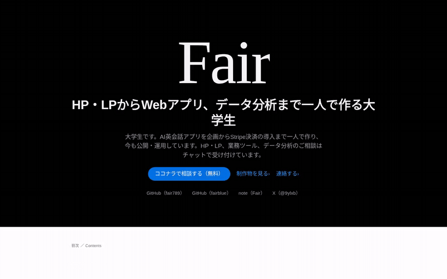

# page-screenshot-tool — Full-Page Screenshot (Chrome Extension + Batch CLI)

Save an entire web page as a single PNG image. Two tools in one repo:

- **Chrome extension** — capture the tab you're viewing (logged-in pages included) with one click or `⌘+Shift+S`
- **CLI** — batch-capture a list of URLs into full-page images

Zero data collection. Fully open source (MIT).

**紹介ページ / Landing page**: https://fairblue.github.io/page-screenshot-tool/



## Chrome extension

Scrolls the page automatically, stitches the shots into one PNG, and downloads it.

**Install**

1. Open `chrome://extensions`
2. Turn on "Developer mode"
3. Click "Load unpacked" and select the `chrome-extension/` folder

**Use**: toolbar button / `Command+Shift+S` (Mac) or `Ctrl+Shift+S` / right-click → "ページ全体を画像で保存". Progress shows on the badge (e.g. 3/12). Files land in your Downloads folder as `hostname-YYYYMMDD-HHmmss.png`.

## CLI

```sh
cd cli
npm install
npx playwright install chromium

./shot.sh https://example.com https://example.org/about
./shot.sh --file urls.txt --out ./shots
```

Options (`--width`, `--viewport`, `--wait`, `--format`) are documented in `cli/README.md`.

## Notes

- Fixed-position headers repeat at stitch boundaries (extension)
- Extremely long pages are scaled down to fit image limits (extension)
- Browser-internal pages (`chrome://`) cannot be captured
- Please don't use this to infringe on others' rights

## License

MIT — see `LICENSE`.

---

# ページ全体スクリーンショット（日本語）

Webページの全体を、1枚の画像（PNG）として保存するツール集です。用途に合わせて2つの形があります。

| 形 | 向いている用途 |
| --- | --- |
| **Chrome拡張機能**（`chrome-extension/`） | 今ブラウザで見ているページをその場で保存。ログイン中のページも撮れます |
| **CLI**（`cli/`） | URLを複数まとめて一括保存。リストファイル対応 |

## Chrome拡張機能

今見ているタブのページ全体を、スクロールしながら撮影して1枚につなぎ、ダウンロードします。

### 導入

1. Chromeで `chrome://extensions` を開く
2. 右上の「デベロッパーモード」をオンにする
3. 「パッケージ化されていない拡張機能を読み込む」を押し、`chrome-extension/` フォルダを選ぶ

### 使い方

- ツールバーのボタンを押す
- ショートカット：Mac は `Command+Shift+S`、Windows は `Ctrl+Shift+S`
- ページ上で右クリック →「ページ全体を画像で保存」

撮影中はバッジに進捗（例：3/12）が出ます。保存先は通常のダウンロードフォルダで、ファイル名は「ホスト名-日時.png」です。

詳しくは `chrome-extension/README.md` をご覧ください。

## CLI

URLを引数やリストファイルで渡すと、各ページ全体の画像を一括で保存します。

```sh
cd cli
npm install
npx playwright install chromium

./shot.sh https://example.com https://example.org/about
./shot.sh --file urls.txt --out ./shots
```

オプション（`--width`、`--viewport`、`--wait`、`--format` など）の詳細は `cli/README.md` をご覧ください。

## 注意

- 固定表示（`position: fixed`）のヘッダーなどは、拡張機能版ではつなぎ目ごとに写り込みます
- 極端に長いページは、画像サイズの上限に合わせて自動で縮小されます（拡張機能版）
- `chrome://` などのブラウザ内部ページは撮影できません
- 他者の権利を侵害する用途には使わないでください

## ライセンス

MIT License（`LICENSE` を参照）
